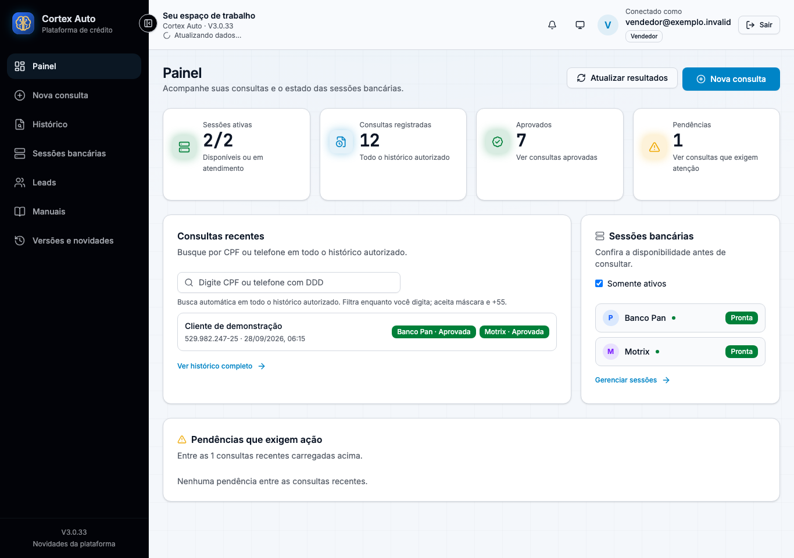

# Cortex Auto · Apresentação do projeto

Uma plataforma para organizar consultas de financiamento de veículos, combinando automação de navegador, assistência de IA validada e intervenção humana pelo terminal remoto.

**Autor: [Cosme Alves](https://github.com/cosmeaf).** Cooperação técnica: Codex e Claude, ferramentas de assistência ao desenvolvimento.

**[Abrir apresentação](https://cortex-all.github.io/cortex-auto-showcase/)** · [Implementar](docs/getting-started.md) · [Manual](docs/user-guide.md) · [Robô + IA](docs/architecture.md) · [GitFlow](docs/gitflow.md) · [Versionamento](docs/versioning.md)

## Produto e finalidade

- Cadastro de cliente e condições de veículo em uma interface única.
- Adapters para Santander, PAN, BV e Motrix, com regras específicas.
- Workers bancários isolados, filas e VNC na VPS Linux.
- Histórico, retornos e evidências para acompanhar a operação.
- Assistência de IA limitada por schema, confiança, opções e tentativas.

As telas usam dados sintéticos e APIs simuladas. Não demonstram aprovação de crédito real nem homologação de todos os cenários bancários.

## Engenharia e entrega

React e TypeScript no frontend; Django REST, PostgreSQL e Redis no backend; Playwright, VNC e containers Linux para a operação. Testes automatizados, TypeScript, lint e build precedem a promoção para staging. Produção tem um fluxo separado.

## Acesso e autoria

Este repositório publica somente apresentação, documentação selecionada e telas sintéticas. O código da aplicação permanece [privado](https://github.com/cortex-all/cortex-auto-v3). Referências técnicas podem exigir autorização. Consulte [Autoria](AUTHORS.md).
